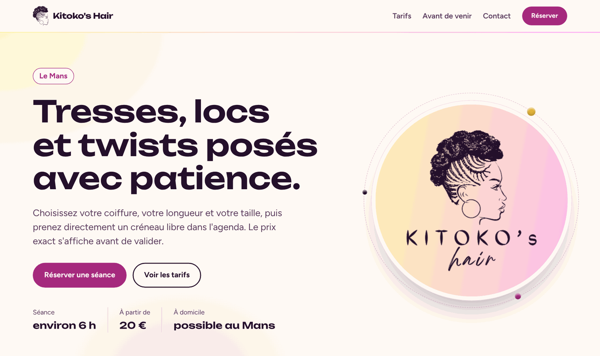
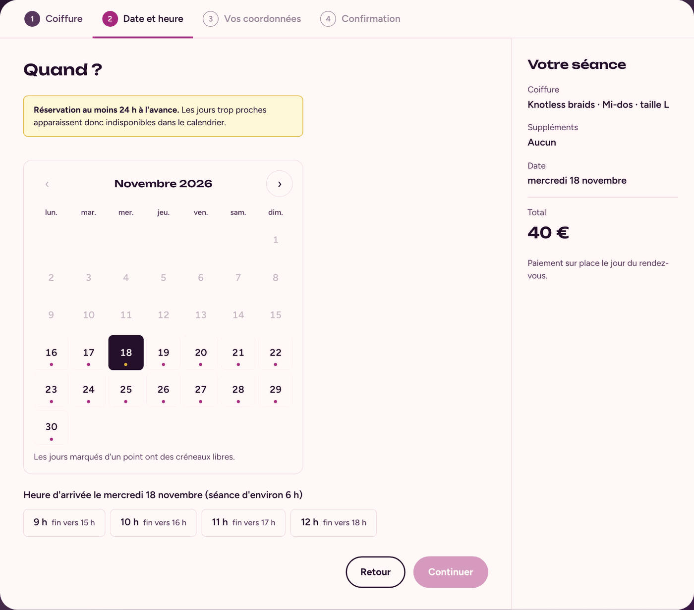
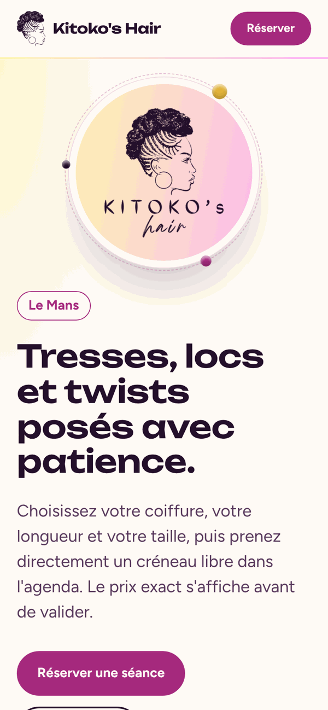

# KITOKO's HAIR

**Le site de réservation de KITOKO's HAIR, coiffeuse spécialisée en tresses, locs et twists au Mans.**
Les clientes choisissent leur coiffure, voient le prix exact et réservent un créneau libre dans l'agenda de la coiffeuse, en quelques clics.

### [👉 Voir le site](https://kitokoshair.github.io/)

📞 06 44 89 17 22 · 📸 [@kitoko_hair_officiel](https://www.instagram.com/kitoko_hair_officiel)

## Ce que propose le site

**Pour les clientes**
- **Plus de 35 coiffures** classées par famille : tresses, courtes et bouclées, twists, locs, nattes collées, tissage et homme.
- **Soins & lissage** (brushing, lissage temporaire, défrisage, lissage au tanin ou à la kératine) et **Kitoko's Nail** pour les ongles et les soins des pieds.
- **Prix affiché tout de suite** selon la longueur et la taille des tresses (S, M ou L), avec les suppléments choisis (perles, version bohème, shampoing…).
- **Réservation en 4 étapes** : coiffure, date et heure, coordonnées, confirmation.
- **Calendrier toujours à jour** : seuls les créneaux réellement libres sont proposés, **7 jours sur 7, de 9 h à 18 h**.
- **Mèches** : la cliente choisit de venir avec ses mèches ou de les faire fournir par la coiffeuse (sur devis).
- **Coiffure à domicile** possible au Mans.
- **Plan d'accès** : la cliente entre son adresse et voit tout de suite son temps de trajet à pied et en voiture, avec le chemin sur la carte (et un lien pour le tram ou le bus).
- Un **e-mail de confirmation** avec un lien pour annuler facilement.
- Un site agréable sur téléphone comme sur ordinateur.
- **Application à installer** gratuitement sur iPhone et Android, depuis le site (bouton « Installer l'appli »), sans passer par l'App Store.

**Pour la coiffeuse**
- Chaque demande arrive **directement dans son Google Agenda** et par e-mail.
- Elle **confirme ou refuse** en un clic : la cliente est prévenue automatiquement.
- Un rendez-vous perso ou un jour de congé ajouté dans l'agenda bloque le site automatiquement.

<table>
  <tr>
    <td width="70%"></td>
    <td width="30%"></td>
  </tr>
</table>

## Règles de réservation

| | |
|---|---|
| ⏰ Délai | Réservation **au moins 12 h à l'avance** |
| 💇🏾‍♀️ Durée | Une séance dure environ **6 h** |
| 🗓️ Horaires | Tous les jours, de **9 h à 18 h** |
| ❌ Annulation | **Gratuite jusqu'à 72 h** avant le rendez-vous |
| ⌛ Retard | 5 € par tranche de 15 minutes |
| 💶 Paiement | Sur place, le jour du rendez-vous |

## Modifier le site

La plupart des changements se font dans deux fichiers, sans connaissance technique particulière :

- [`assets/js/services.js`](assets/js/services.js) : les **coiffures et les prix**. Un prix changé ici est mis à jour partout sur le site.
- [`assets/js/config.js`](assets/js/config.js) : le **téléphone**, l'**Instagram**, les **horaires**, le **délai de réservation** et la **durée d'une séance**.

Après un changement, le site se met à jour tout seul en une ou deux minutes.

> Pour les horaires et le délai de réservation, il faut aussi modifier le script de l'agenda (dossier [`apps-script`](apps-script/)), qui fait les mêmes vérifications de son côté.

## Confidentialité

Les informations des clientes (nom, téléphone, e-mail) restent uniquement dans l'agenda et la boîte mail de la coiffeuse. Le site public ne voit que les horaires occupés, jamais le détail des rendez-vous.

## Crédits

Conçu et développé par [Dave Célestin](https://github.com/Dokceles) pour KITOKO's HAIR.
Code sous licence [MIT](LICENSE).
